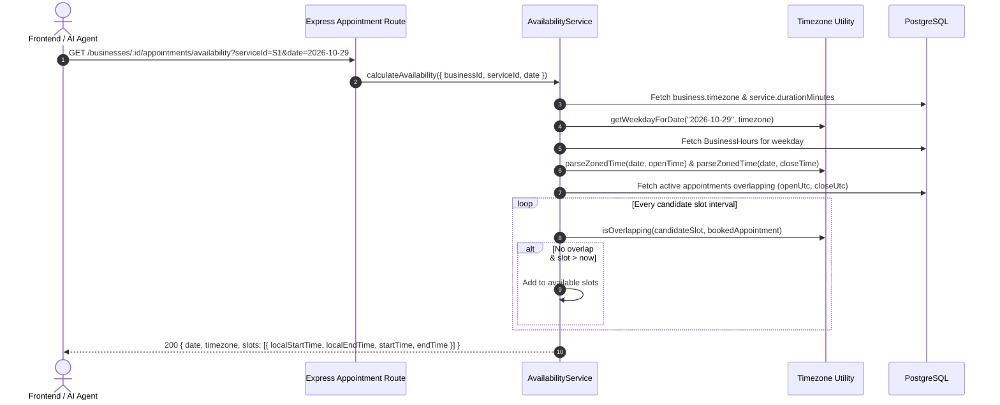
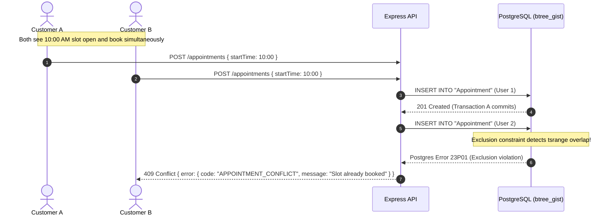
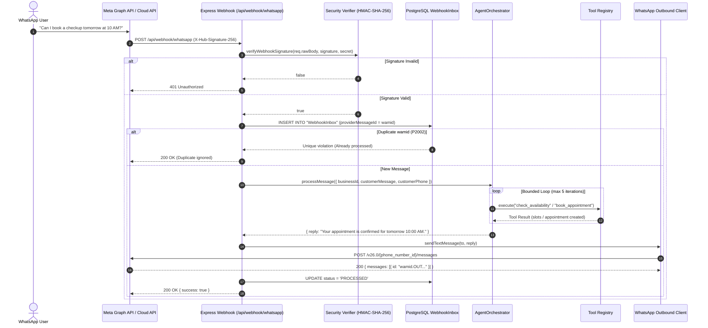

# OpsPilot — Architecture Specification

## 1. Full-Stack Architecture & Integration

```
                               OPSPILOT FULL-STACK ARCHITECTURE

   Browser Client (React 19)
        │
        │ Calls same-origin Next.js Route Handlers
        ▼
   ┌────────────────────────────────────────────────────────────────────────┐
   │                    Next.js 16 (App Router) — :3001                     │
   │                                                                        │
   │   Components: AppShell, Appointments, Services, Hours, Settings        │
   │   State: React AuthContext (user, activeBusiness, businesses)          │
   │                                                                        │
   │   Route Handlers:                                                      │
   │   • /api/auth/[action]  ──> Manages `opspilot_token` HttpOnly cookie    │
   │   • /api/proxy/[...path] ──> Injects `Bearer <token>` & proxies        │
   └────────────────────────────────────┬───────────────────────────────────┘
                                        │ HTTP Proxy (Server-to-Server)
                                        ▼
   ┌────────────────────────────────────────────────────────────────────────┐
   │                       Express 5 Web API — :4000                        │
   │                                                                        │
   │   [Helmet] ──> [CORS] ──> [Rate Limiter] ──> [requireAuth Middleware]   │
   │                                                        │               │
   │   ┌────────────────────┬───────────────────────────────┴──────────┐    │
   │   ▼                    ▼                                          ▼    │
   │ Auth Routes       Business Routes                             Health   │
   │ (/api/auth)       (/api/businesses)                         (/api/health)
   │   │                    │                                          │    │
   │   ▼                    ▼                                          │    │
   │ AuthService       BusinessService                                 │    │
   │                   ├── AvailabilityService (Timezone, slots)       │    │
   │                   └── AppointmentService (Lifecycle, 409 guard)   │    │
   │                        │                                          │    │
   │                        ▼                                          │    │
   │                   Prisma Client (PrismaPg adapter)                │    │
   └────────────────────────┼──────────────────────────────────────────┘    │
                            │                                               │
                            ▼                                               ▼
               PostgreSQL 16 Engine (:5433)                    PostgreSQL Test DB
               • btree_gist extension                          (opspilot_test)
               • EXCLUDE USING gist (Appointment_no_overlap)
```

---

## 2. Timezone & Availability Architecture



---

## 3. Concurrency Protection & Conflict Sequence



---

## 4. Frontend / Backend Contract Alignment

| Next.js Screen | Express Backend Endpoint | Method | Status |
| :--- | :--- | :--- | :--- |
| **Login / Register** | `/api/auth/login`, `/api/auth/register` | `POST` | Verified & Active |
| **User Session** | `/api/auth/me` | `GET` | Verified & Active |
| **Business Selection** | `/api/businesses` | `GET`, `POST` | Verified & Active |
| **Business Settings** | `/api/businesses/:id` | `GET`, `PATCH` | Verified & Active |
| **Services Catalog** | `/api/businesses/:id/services` | `GET`, `POST` | Verified & Active |
| **Working Hours** | `/api/businesses/:id/hours` | `GET`, `PUT` | Verified & Active |
| **Availability Lookup** | `/api/businesses/:id/appointments/availability` | `GET` | Verified & Active (Milestone 2) |
| **Appointments List** | `/api/businesses/:id/appointments` | `GET` | Verified & Active (Milestone 2) |
| **Book Appointment** | `/api/businesses/:id/appointments` | `POST` | Verified & Active (Milestone 2) |
| **Reschedule Appointment**| `/api/businesses/:id/appointments/:id` | `PATCH` | Verified & Active (Milestone 2) |
| **Cancel Appointment** | `/api/businesses/:id/appointments/:id/cancel` | `POST` | Verified & Active (Milestone 2) |
| **Customer Directory** | `/api/businesses/:id/customers` | `GET` | Verified & Active (Milestone 2) |
| **AI Conversations** | `/api/businesses/:id/conversations` | `GET` | Milestone 3 & 4 |
| **Approvals** | `/api/businesses/:id/approvals` | `GET` | Milestone 3 |
| **Activity Feed** | `/api/businesses/:id/activity` | `GET` | Milestone 4 |

---

## 5. WhatsApp Business Cloud API & Agent Orchestration Architecture


